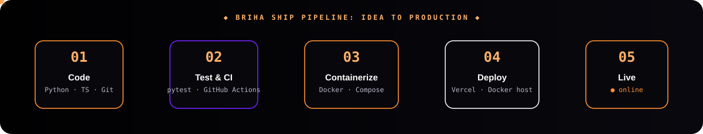

<div align="center">



<a href="https://git.io/typing-svg"></a>

<p>
  <a href="https://www.linkedin.com/in/syed-asad-abbas-28151b302"></a>
  <a href="https://github.com/asad110abbas?tab=repositories"></a>
  
  
  
</p>

</div>

> [!NOTE]
> **BRIHA** is my brand: the local name of my **AI-driven world**. Every project below is a part of it, from
> agents that reason over live business data, to voices that talk to customers in their own language, to the
> data and cloud systems that power them. **Designed, built and shipped by Syed Asad Abbas.**


<div align="center">
  
</div>

<table>
<tr>
<td align="center" width="16%"><b>🤖<br/>Chatbot</b><br/><sub>Agentic LLM</sub></td>
<td align="center" width="16%"><b>🎙️<br/>Voice</b><br/><sub>Real-time AI</sub></td>
<td align="center" width="16%"><b>🧠<br/>Research</b><br/><sub>RAG · NLP · CV</sub></td>
<td align="center" width="16%"><b>📊<br/>Data Lab</b><br/><sub>BI · ML · SQL</sub></td>
<td align="center" width="16%"><b>🧱<br/>Engineering</b><br/><sub>APIs · UIs</sub></td>
<td align="center" width="16%"><b>☁️<br/>Cloud</b><br/><sub>Docker · Vercel</sub></td>
</tr>
</table>


<table>
<tr>
<td width="50%" valign="top">

<a href="https://github.com/asad110abbas/briha-ai-chatbot"></a>

### 🤖 Briha AI Chatbot
*Ask "aaj kitna bika?" and get a **verified** answer in seconds.*

- **4-agent pipeline:** Understand → Retrieve → Validate → Respond
- **Grounding guard:** every number must exist in the source data
- **Bilingual:** English and Roman Urdu, streamed live over SSE
- **Secure:** Argon2, sessions, rate limits, audit log · **78 tests**


</td>
<td width="50%" valign="top">

<a href="https://github.com/asad110abbas/briha-ai-voice-assistant"></a>

### 🎙️ Briha AI Voice Assistant
*A support agent that **listens, thinks and speaks** in English, Urdu and Roman Urdu.*

- **Live voice:** audio over WebSockets → Gemini with function calling
- **RAG brain:** ChromaDB knowledge base + order and billing tools
- **Human hand-off:** smart escalation with ticket and transcript
- **Agent dashboard:** tickets, call records, analytics, exports


</td>
</tr>
</table>


<div align="center">
  
</div>

| Platform | How BRIHA uses it |
|---|---|
|  **Vercel** | Both flagship apps (Briha AI Chatbot and Briha AI Voice Assistant) deployed to the cloud |
|  **Docker / Compose** | Every service containerized: API + PostgreSQL + Nginx stacks, reproducible on any machine or VM |
|  **GitHub Actions** | CI on every push: tests, type checks and builds across Python, TypeScript, Java, Go and R repos |
|  **Nginx + Linux VM** | HTTPS reverse proxy, static frontend serving and on-prem deployment for private data |
|  **PostgreSQL** | Production database with Alembic migrations and nightly backups |


<p align="center">
  <a href="https://github.com/asad110abbas/retail-sales-powerbi-dashboard"></a>
  <a href="https://github.com/asad110abbas/inventory-demand-forecasting"></a>
  <a href="https://github.com/asad110abbas/sql-sales-analytics"></a>
  <a href="https://github.com/asad110abbas/customer-churn-prediction"></a>
</p>

<details open>
<summary><b>📊 Briha Data Lab: analytics, BI and machine learning</b></summary>
<br/>

| Module | What it does | Stack |
|---|---|---|
| 📊 [**Retail Sales Power BI**](https://github.com/asad110abbas/retail-sales-powerbi-dashboard) | Star schema + 30+ DAX measures: YoY, YTD, Pareto, ranking | Power BI · DAX · M |
| 📦 [**Demand Forecasting**](https://github.com/asad110abbas/inventory-demand-forecasting) | 3 backtested models per SKU → safety stock, reorder point, EOQ | statsmodels · sklearn |
| 🗄️ [**SQL Sales Analytics**](https://github.com/asad110abbas/sql-sales-analytics) | Cohorts, RFM, basket analysis, Pareto. CI-tested queries | SQL · PostgreSQL · DuckDB |
| 🔮 [**Churn Prediction**](https://github.com/asad110abbas/customer-churn-prediction) | CV model selection + profit-optimal threshold + model card | scikit-learn |
| 🔄 [**E-commerce ETL**](https://github.com/asad110abbas/ecommerce-etl-pipeline) | Messy data → quarantine → star schema → quality gates | pandas · DuckDB |
| 📈 [**Streamlit KPI Dashboard**](https://github.com/asad110abbas/streamlit-kpi-dashboard) | Interactive KPIs with period-over-period deltas | Streamlit · Plotly |
| 📑 [**Excel Automation**](https://github.com/asad110abbas/excel-report-automation) | One command → formatted Excel report with native charts | openpyxl |
| 📉 [**Sales EDA in R**](https://github.com/asad110abbas/r-sales-eda) | Tidyverse analysis with ggplot2 visuals | R · dplyr · ggplot2 |

</details>

<details>
<summary><b>🧱 Briha Engineering: APIs, UIs and services (click to expand)</b></summary>
<br/>

| Module | What it does | Stack |
|---|---|---|
| ✅ [**Task Manager API**](https://github.com/asad110abbas/task-manager-api) | JWT auth, Zod validation, search and pagination, integration tests | TypeScript · Express · Docker |
| 🖥️ [**React Analytics UI**](https://github.com/asad110abbas/react-analytics-ui) | Responsive analytics dashboard with dark mode | React · TS · Recharts |
| 📚 [**Library Management API**](https://github.com/asad110abbas/library-management-java) | Transactional business rules, RFC 7807 errors | Java 21 · Spring Boot |
| 🔗 [**URL Shortener**](https://github.com/asad110abbas/url-shortener-go) | Zero-dependency, race-tested, graceful shutdown | Go · Docker |

</details>

<details>
<summary><b>🧠 Briha Research: NLP, RAG and computer vision (click to expand)</b></summary>
<br/>

| Module | What it does | Stack |
|---|---|---|
| 🧠 [**RAG Knowledge Bot**](https://github.com/asad110abbas/RAG-based-AI-Chat-Bot) | Retrieval-augmented chatbot over custom documents | LangChain · OpenAI · Gradio |
| 🎯 [**DeBERTa Fine-tuning**](https://github.com/asad110abbas/Fine_Tuning-Deberta-Base) | Transformer fine-tuned for review classification | PyTorch · Hugging Face |
| 💬 [**Hybrid AI Chatbot**](https://github.com/asad110abbas/AI-ChatBot) | AI + rule-based conversational system | Python · NLP |
| 👁️ [**OCR**](https://github.com/asad110abbas/OCR) | Multi-engine text extraction from images | OpenCV · OCR |
| 🧍 [**Gender Identification**](https://github.com/asad110abbas/Gender_Identification) | Image classification model | Deep learning |
| 🕸️ [**Web Mining**](https://github.com/asad110abbas/Web-Mining) · [**Data Mining**](https://github.com/asad110abbas/Data-Mining) | Scraping with pagination, Google Maps data mining | Python · Jupyter |

</details>


<p align="center">
  <b>Languages</b><br/>
  <br/><br/>
  <b>AI · Backend · Frontend</b><br/>
  <br/><br/>
  <b>Cloud · DevOps · Data</b><br/>
  
</p>

<p align="center">
  
  
  
  
  
  
  
  
  
</p>


```python
class SyedAsadAbbas:
    brand    = "BRIHA — The Genesis of AGI"
    role     = "AI & Data Engineer"
    world    = {
        "ai":          ["Multi-agent LLMs", "Real-time Voice AI", "RAG", "Fine-tuning"],
        "data":        ["Power BI", "SQL", "Forecasting", "Churn ML", "ETL"],
        "engineering": ["FastAPI", "React", "Spring Boot", "Go"],
        "cloud":       ["Docker", "Vercel", "GitHub Actions", "Nginx"],
    }
    speaks   = {"code": ["Python", "SQL", "TypeScript", "Java", "Go", "R", "DAX"],
                "human": ["English", "Urdu"]}
    believes = "An AI answer is only as good as the proof behind it."

    def ship(self, idea):
        return idea | build | test | dockerize | deploy("vercel")   # idea -> production
```


<div align="center">


</div>


<div align="center">

### 🤝 Let's build the future together

**Open to AI Engineering · Data Analytics · Full-Stack AI · Cloud roles**

<a href="https://www.linkedin.com/in/syed-asad-abbas-28151b302"></a>
<a href="https://github.com/asad110abbas?tab=repositories"></a>

</div>


