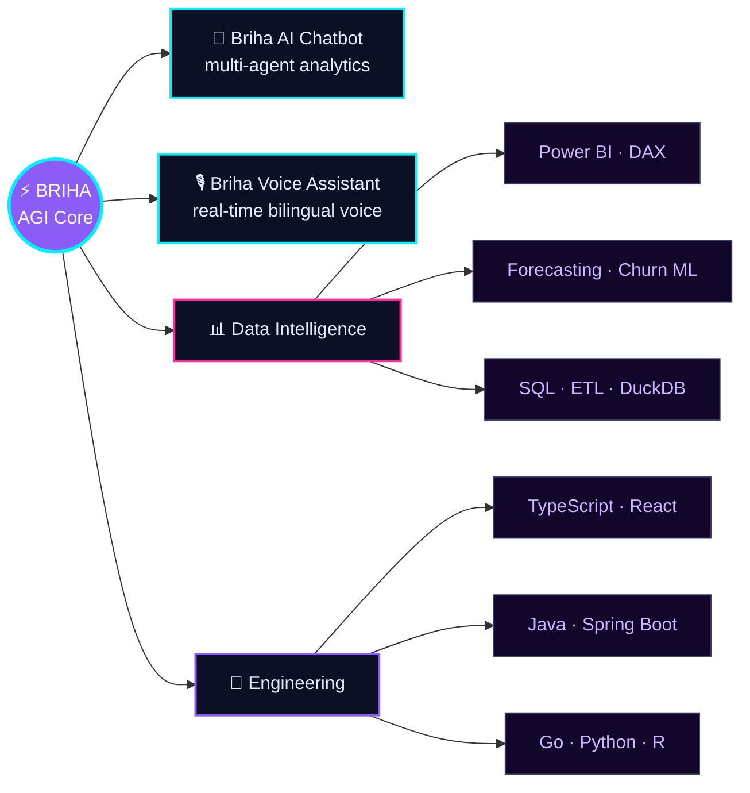

<div align="center">


<br/>

<a href="https://git.io/typing-svg"></a>

<p>
  <a href="https://www.linkedin.com/in/syed-asad-abbas-28151b302"></a>
  <a href="https://github.com/asad110abbas?tab=repositories"></a>
  
  
</p>

</div>


## ⚡ What is BRIHA?

> **BRIHA** is the name of my AI-driven universe: a growing family of intelligent systems I design and build
> end-to-end, from **agents that reason over live business data** to **voices that talk to customers in their own language**.
>
> 🧠 *Think → Retrieve → Validate → Speak.* Every BRIHA system is built around one rule: **an AI answer is only as good as the proof behind it.**

<table>
<tr>
<td width="33%" align="center">
<h3>🧠 Agentic AI</h3>
Multi-agent pipelines with tool use, self-validation and grounding checks
</td>
<td width="33%" align="center">
<h3>🎙️ Voice AI</h3>
Real-time, bilingual speech agents with RAG and human hand-off
</td>
<td width="33%" align="center">
<h3>📊 Data Intelligence</h3>
ETL, forecasting, ML models and BI dashboards that drive decisions
</td>
</tr>
</table>

## 🧬 The BRIHA universe




## 🚀 Flagship: BRIHA AI

<table>
<tr>
<td width="50%" valign="top">

<a href="https://github.com/asad110abbas/briha-ai-chatbot"></a>

**🤖 Briha AI Chatbot**: ask your business *"aaj kitna bika?"* and get a verified answer in seconds.
- 4-agent pipeline: **Understand → Retrieve → Validate → Respond**
- Grounding guard: every number must exist in the source data
- GPT-5 / Gemini / offline mode · FastAPI · React 19 · PostgreSQL · **78 tests**

</td>
<td width="50%" valign="top">

<a href="https://github.com/asad110abbas/briha-ai-voice-assistant"></a>

**🎙️ Briha AI Voice Assistant**: a support agent that *listens, thinks and speaks* in English, Urdu and Roman Urdu.
- Live audio over WebSockets → Gemini with **function calling**
- **RAG** knowledge base (ChromaDB) + smart human escalation
- Full agent dashboard: tickets, call records, analytics

</td>
</tr>
</table>

## 📊 Data intelligence lab

<p align="center">
  <a href="https://github.com/asad110abbas/retail-sales-powerbi-dashboard"></a>
  <a href="https://github.com/asad110abbas/inventory-demand-forecasting"></a>
  <a href="https://github.com/asad110abbas/sql-sales-analytics"></a>
  <a href="https://github.com/asad110abbas/customer-churn-prediction"></a>
</p>

<details>
<summary><b>🔍 Explore every project (click to expand)</b></summary>
<br/>

| | Project | What it does | Stack |
|---|---|---|---|
| 📊 | [Retail Sales Power BI](https://github.com/asad110abbas/retail-sales-powerbi-dashboard) | Star schema + 30+ DAX measures: YoY, YTD, Pareto, ranking | Power BI · DAX · M |
| 📦 | [Demand Forecasting](https://github.com/asad110abbas/inventory-demand-forecasting) | 3 backtested models per SKU → safety stock, reorder point, EOQ | statsmodels · sklearn |
| 🗄️ | [SQL Sales Analytics](https://github.com/asad110abbas/sql-sales-analytics) | Cohorts, RFM, basket analysis, Pareto. CI-tested queries | SQL · PostgreSQL · DuckDB |
| 🔮 | [Churn Prediction](https://github.com/asad110abbas/customer-churn-prediction) | CV model selection + profit-optimal threshold + model card | scikit-learn |
| 🔄 | [E-commerce ETL](https://github.com/asad110abbas/ecommerce-etl-pipeline) | Messy data → quarantine → star schema → quality gates | pandas · DuckDB |
| 📈 | [Streamlit KPI Dashboard](https://github.com/asad110abbas/streamlit-kpi-dashboard) | Interactive KPIs with period-over-period deltas | Streamlit · Plotly |
| 📑 | [Excel Automation](https://github.com/asad110abbas/excel-report-automation) | One command → formatted Excel report with native charts | openpyxl |
| 📉 | [Sales EDA in R](https://github.com/asad110abbas/r-sales-eda) | Tidyverse analysis with ggplot2 visuals | R · dplyr · ggplot2 |
| ✅ | [Task Manager API](https://github.com/asad110abbas/task-manager-api) | JWT auth, Zod validation, search and pagination, integration tests | TypeScript · Express |
| 🖥️ | [React Analytics UI](https://github.com/asad110abbas/react-analytics-ui) | Responsive analytics dashboard with dark mode | React · TS · Recharts |
| 📚 | [Library Management API](https://github.com/asad110abbas/library-management-java) | Transactional business rules, RFC 7807 errors | Java 21 · Spring Boot |
| 🔗 | [URL Shortener](https://github.com/asad110abbas/url-shortener-go) | Zero-dependency, race-tested, graceful shutdown | Go |
| 🧠 | [RAG Knowledge Bot](https://github.com/asad110abbas/RAG-based-AI-Chat-Bot) | Retrieval-augmented chatbot over custom documents | LangChain · OpenAI |
| 🎯 | [DeBERTa Fine-tuning](https://github.com/asad110abbas/Fine_Tuning-Deberta-Base) | Transformer fine-tuned for review classification | PyTorch · HF |
| 👁️ | [OCR](https://github.com/asad110abbas/OCR) · [Web Mining](https://github.com/asad110abbas/Web-Mining) · [Data Mining](https://github.com/asad110abbas/Data-Mining) | Vision, scraping and classic ML | Python · Jupyter |

</details>


## 🛠️ Tech arsenal

<p align="center">
  <br/>
  <br/>
  
</p>

<p align="center">
  
  
  
  
  
  
  
  
  
</p>

## 🧑‍🚀 About the builder

```python
class SyedAsadAbbas:
    brand    = "BRIHA — The New World in AGI"
    role     = "AI & Data Engineer"
    builds   = ["Multi-agent LLM systems", "Real-time voice AI", "RAG pipelines",
                "Forecasting & ML models", "ETL pipelines", "Power BI dashboards"]
    speaks   = {"code": ["Python", "SQL", "TypeScript", "Java", "Go", "R", "DAX"],
                "human": ["English", "Urdu"]}
    believes = "An AI answer is only as good as the proof behind it."

    def mission(self):
        return "Make AI that businesses can actually trust, then ship it."
```


## 📡 Signal from the lab

<div align="center">


</div>

<div align="center">

### 🤝 Let's build the future together

**Open to AI Engineering · Data Analytics · Full-Stack AI roles**

<a href="https://www.linkedin.com/in/syed-asad-abbas-28151b302"></a>

</div>


